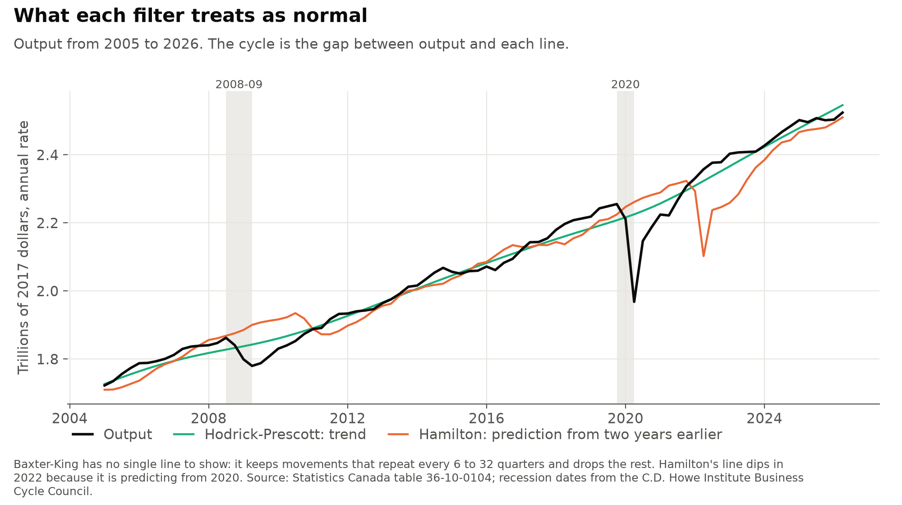
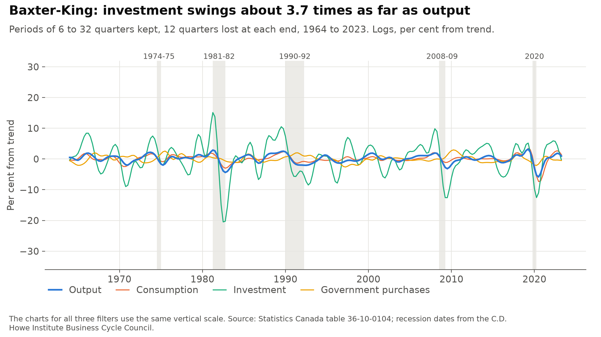
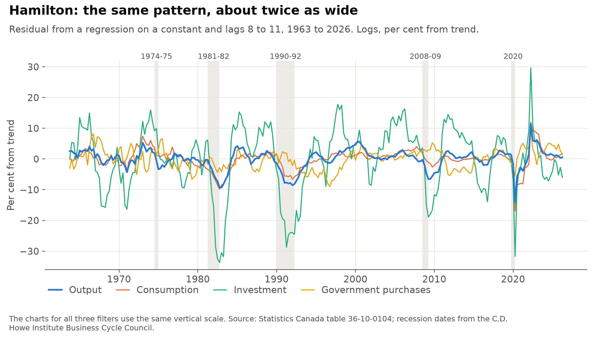
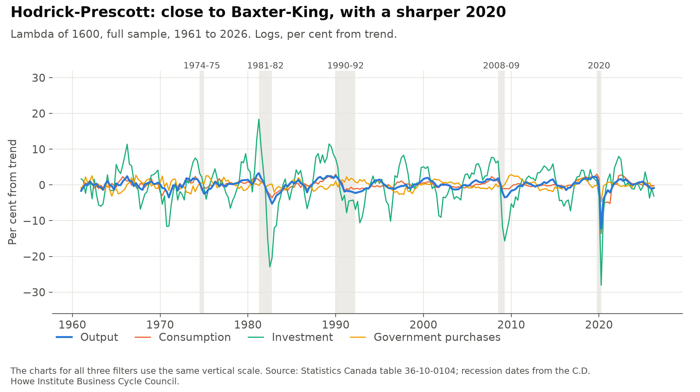
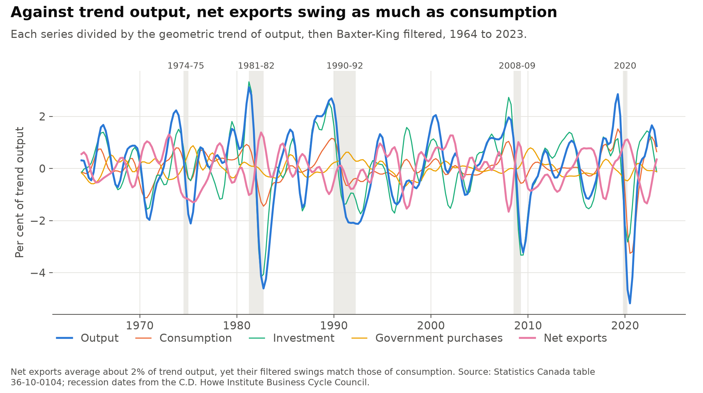
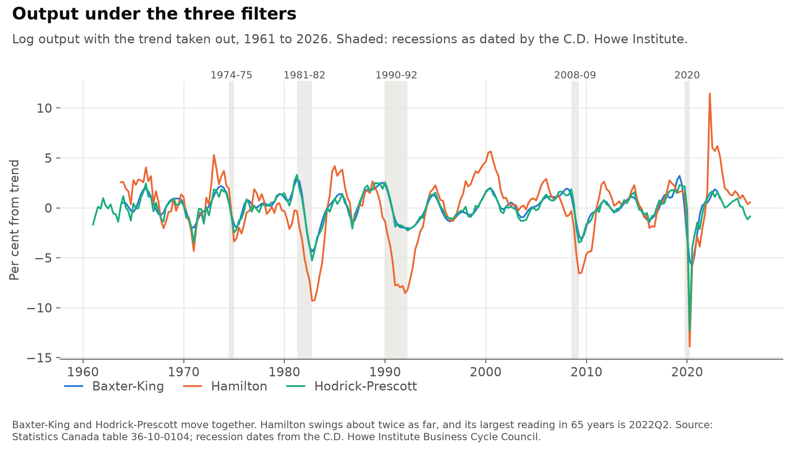
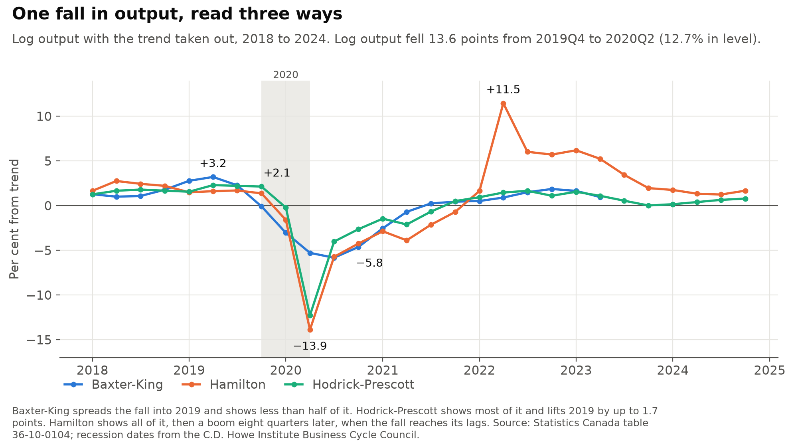

# canada_business_cycles

[](https://github.com/atamalfuzi/canada_business_cycles/actions/workflows/tests.yml)

Canada's economy has grown by about 3% a year on average since 1961, but not steadily. This project measures the rises and falls around that growth, the business cycle, in Canadian output and its parts from 1961 to 2026. It asks how consumption, investment, government purchases and net exports move when output rises or falls, and how the 2020 pandemic recession compares with earlier ones. Separating the cycle from long-run growth takes a method, and three common ones are compared here. Much of the result depends on that choice. Python, with pandas and SciPy.

Results are as of November 2026, with data through the second quarter of 2026 from Statistics Canada's file dated August 28, 2026.

> **Personal project.** This is my own analysis of publicly available data. It is not associated with my work for any current or past employer and does not represent their views.

| Question | Methods | Answer |
|---|---|---|
| [How do the parts of output move with it?](#1-how-the-parts-of-output-move) | Three filters on the log of each series | Investment rises and falls with output and swings 3.4 to 3.7 times as far. Consumption also moves with output. Government purchases are close to unrelated to it. |
| [Do net exports rise or fall when output does?](#2-net-exports) | Shares of trend output, Baxter-King filter, block bootstrap | They lean against output, weakly: a correlation of −0.21 (95% range −0.44 to 0.06), and about zero since 1990. |
| [How does each filter see 2020?](#3-how-each-filter-sees-2020) | Comparison with four earlier recessions, pandemic replaced by a straight line as a test | Output fell 13.6 log points. The filters show lows of −5.8, −12.3 and −13.9, and one of them shows a boom in 2022 that comes from the method itself. |
| [Which filter works best?](#4-which-filter-works-best) | Recession timing, spillover from 2020, revisions as new data arrive | Hodrick-Prescott for describing past cycles. Hamilton for judging the most recent quarter. |

## How the cycle is measured

To study the cycle, you first decide what normal output is at each date, called the trend, and then measure how far actual output is above or below it. That distance is the cycle, or the gap. Every series here is in logs, so a gap of 0.02 means about 2% above trend. Tables and charts show gaps in per cent.

The three filters define normal output in different ways:

- The **Hodrick-Prescott filter** draws a smooth curve through the data. A single setting, lambda, decides how smooth the curve is. This project uses 1600, the usual value for quarterly data. The curve at any date depends on data both before and after it, so its reading of recent years can change as new data arrive.
- The **Baxter-King filter** keeps only movements that repeat every 6 to 32 quarters, that is, from a year and a half to eight years. Slower and faster movements are dropped. It is a weighted average of the 12 quarters on each side of each date, so it has no value for the first and last three years of data.
- The **Hamilton projection** compares output with what you would have predicted two years earlier. The prediction comes from a regression of output on a constant and its own values 8, 9, 10 and 11 quarters before. It uses only the past, so it has a value up to the latest quarter.



Two statistics describe each series:

- The **standard deviation** is the typical size of its swings, in per cent from trend.
- The **correlation with output** shows whether it moves with output. It is +1 if the series rises and falls exactly with output, 0 if there is no relation, and −1 if it moves the opposite way. A series that moves with output is called procyclical, and one that moves against it countercyclical.

## Data

All series come from [Statistics Canada table 36-10-0104](https://www150.statcan.gc.ca/t1/tbl1/en/tv.action?pid=3610010401), quarterly, in chained 2017 dollars, seasonally adjusted at annual rates.

| Series | Built from the table as |
|---|---|
| Output | Gross domestic product at market prices |
| Consumption | Final consumption, less government consumption and less durable goods such as cars and appliances, which are counted as investment |
| Investment | Gross fixed capital formation by businesses (including housing) and non-profit institutions, plus household durable goods and investment in inventories |
| Government purchases | Government consumption plus government investment |
| Net exports | Exports less imports |

Chained-dollar series don't add up exactly, so the parts are close approximations. Together they miss output by at most 2.3% (in 1965), and by at most 0.6% since 2000.

Recession dates are from the [C.D. Howe Institute Business Cycle Council's chronology](https://cdhowe.org/wp-content/uploads/2024/06/Recession_Chronology_0.xlsx) (2021 version), read from the file itself. Within these data there are five: 1974-75, 1981-82, 1990-92, 2008-09 and 2020. The 1960-61 recession ends in the first quarter of the data and is left out. The [Council's page](https://cdhowe.org/council/business-cycle-council) lists no later recession as of November 2026.

## 1. How the parts of output move

Each series is logged and then filtered three ways: Baxter-King with bounds of 6 and 32 quarters and 12 quarters on each side, Hamilton with lags 8 to 11, and Hodrick-Prescott with a lambda of 1600. The three charts use the same vertical scale.







Standard deviation in per cent, and correlation with output:

| All quarters | Baxter-King, 1964Q1 to 2023Q2 | | Hamilton, 1963Q4 to 2026Q2 | | Hodrick-Prescott, 1961Q1 to 2026Q2 | |
|---|---:|---:|---:|---:|---:|---:|
| | SD | Corr. | SD | Corr. | SD | Corr. |
| Output | 1.46 | 1.00 | 3.19 | 1.00 | 1.56 | 1.00 |
| Consumption | 1.37 | 0.84 | 3.20 | 0.81 | 1.52 | 0.82 |
| Investment | 5.43 | 0.84 | 10.68 | 0.82 | 5.68 | 0.81 |
| Government purchases | 1.08 | −0.03 | 3.21 | 0.16 | 1.21 | 0.03 |

| Through 2019Q4 | Baxter-King | | Hamilton | | Hodrick-Prescott | |
|---|---:|---:|---:|---:|---:|---:|
| | SD | Corr. | SD | Corr. | SD | Corr. |
| Output | 1.32 | 1.00 | 2.96 | 1.00 | 1.36 | 1.00 |
| Consumption | 1.03 | 0.82 | 2.59 | 0.76 | 1.09 | 0.77 |
| Investment | 5.36 | 0.86 | 10.76 | 0.84 | 5.58 | 0.82 |
| Government purchases | 1.08 | −0.13 | 3.09 | 0.08 | 1.22 | −0.11 |

The three filters agree on the pattern. Investment is the most volatile series and moves closely with output. Consumption also moves with output. Government purchases have no clear relation to output, which fits spending that is set by budgets more than by the cycle. Hamilton's swings are about twice as large as the other two, because a gap measured against a two-year-old prediction includes slower movements that the other filters count as trend.

Which series is least volatile depends on the pandemic. Through 2019, consumption is the least volatile under all three filters, and it is smoother than output, as households tend to keep spending steady through good and bad years. With 2020 included, consumption's swings grow to about the size of output's, and government purchases become the least volatile under Baxter-King and Hodrick-Prescott. In 2020, lockdowns cut consumption further than output under all three filters: −13.6 against −12.3 under Hodrick-Prescott, for example. In the four earlier recessions, consumption's low was a third to three-quarters of output's under Baxter-King and Hodrick-Prescott.

Including inventories in investment matters. They rise and fall sharply with sales, so they add to investment's swings. Without them, investment swings about 2.5 times as far as output under all three filters, against 3.4 to 3.7 times with them, and its correlation with output falls from 0.81-0.84 to 0.73-0.76.

## 2. Net exports

Net exports are sometimes negative, so they have no log and can't be filtered like the other series. Instead, a straight line is fitted to log output and converted back to dollars, which gives a trend that grows at a constant rate. Each series, net exports included, is divided by that trend and then put through the same Baxter-King filter.



| Share of trend output, 1964Q1 to 2023Q2 | SD, per cent of trend output | Correlation with output | Share of output's variance |
|---|---:|---:|---:|
| Output | 1.46 | 1.00 | 100% |
| Consumption | 0.63 | 0.82 | 36% |
| Investment | 1.23 | 0.85 | 71% |
| Government purchases | 0.31 | −0.07 | −1% |
| Net exports | 0.67 | −0.21 | −10% |

These numbers differ from the log tables because the unit differs. A log measures each swing against the series' own size, while a share measures it against the whole economy. Investment swings 3.7 times as far as output in logs, but it is only about a quarter of output, so its swings here are 0.84 times those of output. Even so, investment accounts for 71% of the variance of output, about twice the part from consumption. Net exports average only about 2% of trend output, yet their swings are as large as those of consumption. The parts add to 96% rather than 100% because chained series don't add up exactly.

Net exports lean against output, weakly. They often rise when output falls, because imports drop with spending at home. From peak to trough they rose by 2.2 points of trend output in 1981-82, 1.3 in 2008-09 and 0.3 in 2020, and barely moved (−0.1 each) in 1974-75 and 1990-92. The evidence is not strong:

| Period | Correlation of net exports with output | 95% range |
|---|---:|---:|
| 1964Q1 to 2023Q2 | −0.21 | −0.44 to 0.06 |
| 1964Q1 to 2019Q4 | −0.15 | −0.42 to 0.14 |
| 1964Q1 to 1989Q4 | −0.37 | −0.75 to 0.10 |
| 1990Q1 to 2019Q4 | 0.07 | −0.26 to 0.43 |

Filtered series change slowly, so neighbouring quarters are not independent. The ranges account for this by resampling blocks of 16 quarters rather than single quarters. Blocks of 8 to 32 quarters give about the same range for the first two rows. Every range includes zero, and the negative correlation comes mostly from before 1990. Timing matters as well: the correlation is −0.24 when net exports lead output by one quarter, and +0.22 when they trail it by five quarters.

So net exports are countercyclical in sign, but weakly, and since 1990 they have had no clear relation to the cycle.

## 3. How each filter sees 2020



Log output fell 13.6 points from 2019Q4 to 2020Q2, or 12.7% in level. That is about four times the average fall in the four earlier recessions. The table shows each filter's lowest reading within four quarters of each recession, with the quarter in brackets.

| Recession | Peak to trough, by quarter | Fall in log output | Baxter-King low | Hamilton low | Hodrick-Prescott low |
|---|---|---:|---:|---:|---:|
| 1974-75 | 1974Q3 to 1975Q1 | 1.1 | −2.0 (1975Q2) | −3.4 (1975Q1) | −2.5 (1975Q1) |
| 1981-82 | 1981Q2 to 1982Q4 | 5.5 | −4.4 (1982Q4) | −9.3 (1982Q4) | −5.3 (1982Q4) |
| 1990-92 | 1990Q1 to 1992Q2 | 2.5 | −2.1 (1992Q3) | −8.5 (1992Q1) | −2.3 (1992Q2) |
| 2008-09 | 2008Q3 to 2009Q2 | 4.5 | −3.2 (2009Q3) | −6.6 (2009Q2) | −3.5 (2009Q2) |
| 2020 | 2019Q4 to 2020Q2 | 13.6 | −5.8 (2020Q3) | −13.9 (2020Q2) | −12.3 (2020Q2) |
| 2020 against the average of the other four | | 4.0 times | 2.0 times | 2.0 times | 3.7 times |

All three filters show 2020 as the deepest of these recessions. They differ in how much deeper it was, and in what they show around it.



Baxter-King shows 2020 as about twice the usual size, though the fall in output was four times the usual size. Output fell and largely recovered within a few quarters, and much of a movement that fast is quicker than the filter's 6-quarter limit, so the filter drops it. Because it averages over quarters on both sides, it also starts falling in 2019, before the recession, and puts the low one quarter late.

Hodrick-Prescott comes closest to the size and timing of the fall. Its trend bends down to meet the fall, which makes output look above trend just before it.

Hamilton shows the whole fall, because it compares output with a prediction made two years earlier, before the pandemic. The same comparison causes a false boom later. From 2022, the prediction is based on the low quarters of 2020, so it is low and output looks high. Its 2022Q2 reading of +11.5 is the largest in the whole sample, nearly twice the next highest. The dip in Hamilton's line in the chart under [How the cycle is measured](#how-the-cycle-is-measured) shows this directly.

To measure how far 2020 spills into other quarters, I replaced 2020Q1 to 2021Q3 with a straight line, ran each filter again and took the difference. Output was back at its 2019Q4 level by 2021Q3, so the line removes the fall and little else.

| Filter | Largest change before 2020 | Largest change after 2021Q3 |
|---|---:|---:|
| Baxter-King | +2.6 (2019Q2) | +1.2 (2022Q4) |
| Hamilton | −1.5 (2011Q1) | +10.6 (2022Q2) |
| Hodrick-Prescott | +1.7 (2019Q4) | +1.6 (2021Q4) |

Most of Baxter-King's 2019Q2 reading of +3.2 comes from 2020, and that reading is the filter's highest in the sample. Hamilton's change in 2011 comes through its regression, which is estimated once on all the data, so a large 2020 changes the prediction for every quarter.

After the low, the filters agree more. They return to zero 4 quarters (Baxter-King), 6 (Hodrick-Prescott) and 7 (Hamilton) after the low, against averages of about 6, 7 and 8 quarters for the four earlier recessions. So all three show a somewhat faster recovery than usual, from a much deeper low.

## 4. Which filter works best

For describing past business cycles, Hodrick-Prescott does best on these tests. For judging the most recent quarter, Hamilton is the better choice.

| Test | Baxter-King | Hamilton | Hodrick-Prescott |
|---|---:|---:|---:|
| Low falls in the dated trough quarter, of 5 recessions | 1 | 4 | 5 |
| Output above trend at the dated peak, of 5 recessions | 4 | 2 | 5 |
| Largest spillover from 2020 outside the pandemic, points | 2.6 | 10.6 | 1.7 |
| 2020 against the average of the other four (output: 4.0 times) | 2.0 times | 2.0 times | 3.7 times |
| Latest quarter with a value | 2023Q2 | 2026Q2 | 2026Q2 |

Hodrick-Prescott's weakness is the most recent years. When a new quarter of data arrives, the filter's readings for recent quarters can change. To measure this, I ran the filters on the data available up to each quarter from 1985 onward and compared that first reading with the reading from all the data. The data are held at their current published values, so this counts only changes that come from the filter.

| Filter | Correlation of first reading with final | First reading has the wrong sign | Typical revision, points | SD of final reading |
|---|---:|---:|---:|---:|
| Hamilton | 0.95 | 12% | 1.44 | 3.29 |
| Hodrick-Prescott | 0.63 | 37% | 1.41 | 1.61 |

The typical revision is the root mean square. Through 2019, Hodrick-Prescott's correlation is 0.44 and its wrong-sign share 39%, while Hamilton's are 0.95 and 14%. Hodrick-Prescott's revisions are almost as large as its readings, so its first reading for a recent quarter says little. Baxter-King has no reading at all for the last three years. The filters also disagree about the present: for 2026Q2, Hamilton shows output 0.6% above normal, Hodrick-Prescott 0.9% below, and Baxter-King has no value.

## Limits

- These tests reward a series that follows output closely, and the Council's dates rest partly on GDP. That leans them toward Hodrick-Prescott and Baxter-King.
- Hamilton's larger swings are not simply error. Its −8.5 for 1990-92 reflects how far output ended up below where it would normally have been two years on, which is a real feature of that long slump. Its readings at three of the five peaks are slightly below zero (−0.3 to −1.3) because it compares with a two-year-old prediction, and output at those peaks was close to what two years of normal growth would have given.
- [Hamilton (2018)](https://doi.org/10.1162/rest_a_00706) argues that Hodrick-Prescott can create cycles in a series that has none. These tests don't check that.
- A lambda of 1600 and Baxter-King's bounds of 6 and 32 quarters are conventions, and other values would change the numbers.
- Each filter's table uses the quarters that filter has, so the samples differ a little. The through-2019 table shows the effect of the pandemic on its own.
- The trend used for net exports is one constant growth rate over 65 years, so output runs from 0.76 to 1.12 times that trend as growth slowed. The Baxter-King filter removes that slow movement, but the shares are measured against a trend that is not always close to actual output.

## Checks

- Tests check the filters against properties they must have: Baxter-King weights that are symmetric and sum to zero, Hamilton residuals that are uncorrelated with the constant and each lag, and a Hodrick-Prescott cycle with no linear trend left in it. They also compare Baxter-King and Hodrick-Prescott with the statsmodels versions, and check how the table is read and the series are built.
- The tables quoted here are in `output/`, one CSV file each, including the inventory check in `output/inventories.csv`.

## Run it

```bash
pip install -r requirements-dev.txt
python data.py
python estimate.py
python figures.py
pytest
```

`data.py` downloads the table to `data/`, which is not committed. `estimate.py` writes the tables to `output/`, and `figures.py` draws the charts in `figures/`. New data will change the numbers, and the text above describes the file dated August 28, 2026.

## References

- Baxter, M. and King, R. G. (1999). Measuring business cycles: approximate band-pass filters for economic time series. *Review of Economics and Statistics*, 81(4), 575-593.
- Hamilton, J. D. (2018). Why you should never use the Hodrick-Prescott filter. *Review of Economics and Statistics*, 100(5), 831-843.
- Hodrick, R. J. and Prescott, E. C. (1997). Postwar U.S. business cycles: an empirical investigation. *Journal of Money, Credit and Banking*, 29(1), 1-16.

## License

MIT. See [LICENSE](LICENSE).
